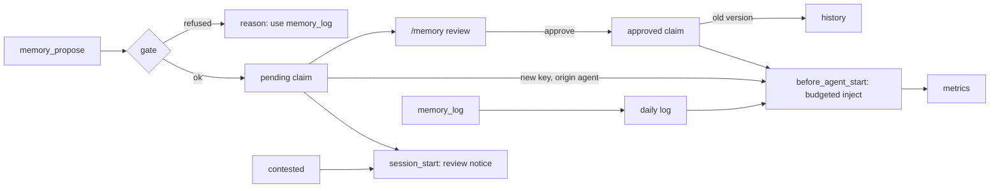

# Spec: budgeted, governed memory for Pi
From: intent.md (Rodrigo Lazoti). Status: decisions applied 2026-10-16; ready for product owner review.
Skills applied: none matched (no memory or extension-design skill is installed). Inputs: intent.md only.
It points to two documents, which are followed where it does: rl-pi-extensions `AGENTS.md` (named
in its constraints) and Pi's extension API docs (`session_start` and `before_agent_start` hooks).

## Requirements

### Scope
- R1. The extension owns three kinds of memory: **rules** (preferences, how Rodrigo works),
  **facts** (domain facts and invariants) and the **daily log**. Nothing else.
- R2. Projects live outside memory (local directory, GitHub, any URI). A claim may link to one. No
  project list is stored or injected.
- R3. One machine. The extension has no sync logic and no sync-specific checks (D8).

### Storage and grammar
- R4. Rules and facts are markdown entries with a strict grammar.
  - Required fields: `key`, `kind` (`rule` | `fact`), `scope`, `asOf`, `source`.
  - Optional fields: `aliases`, `tags`, `links`, `origin` (`agent` | `migration`).
  - The body is plain prose of at most 600 characters.
- R5. `asOf` and `source` are never filled in by the extension. An entry without either is
  malformed: it is reported and not injected.
- R6. write → read → write is byte-stable for every file the extension writes.
- R7. Files are hand-editable. A hand edit that breaks the grammar is reported with file and line,
  and only that entry is excluded.

### Scope resolution
- R8. `scope` is `global`, `project:<id>` or `path:<glob>`. `<id>` is derived from the git remote,
  or else the repo root, of the session's working directory.
- R9. Out-of-scope claims are never injected or returned by automatic recall.
- R10. For one key, a narrower scope shadows a broader one (`path` > `project` > `global`). One
  question gets one answer.

### One current claim per key
- R11. An identity (`key` + `scope`) has at most one approved claim and at most one pending claim.
- R12. If an identity has two approved claims (for example after a hand edit), it is **contested**:
  nothing is injected for it, and it is listed in the session-start notice (R20).
- R13. Approving a pending claim replaces the approved one. The old claim moves word for word to
  `history/` with a `supersededAt` date. Nothing is deleted.
- R14. A body containing supersession prose ("superseded", "historical", "no longer", "replaced by")
  is refused at write time. The reason says to propose a new claim for the key instead.

### Writes (tiered)
- R15. `memory_log` appends one item to today's daily log. Sections: `completed`, `in_progress`,
  `decision`, `carry`, `note`. The extension stamps date and time, and the agent cannot set them.
- R16. The extension never writes auto-persist or session-summary lines.
- R17. `memory_propose` creates or replaces the pending claim for an identity. The agent cannot
  write approved claims.
- R18. `/memory review` lists pending claims in batches, each next to the approved claim it would
  replace. Actions per claim or per batch: approve, reject, edit, defer. Migration claims are
  reviewed as their own batch, by wave.
- R19. Config `inlineConflictDialog` (default `false`): when `true`, a proposal that would replace an
  approved claim opens a dialog right away. Dialogs are shown one at a time and cancel with the
  tool call.

### Review notice (D1)
- R20. On `session_start` for a new session, if anything waits for Rodrigo, the extension shows one
  notice with counts:
  - new proposals (`origin: agent`);
  - migration backlog (`origin: migration`), counted separately (D9);
  - contested identities (R12);
  - claims pending longer than `pendingFlagDays` (default 14).
  The notice names `/memory review`. It never blocks the session. With nothing pending, nothing is
  shown. Outside TUI mode it is written once to the log instead.
- R21. Claims are never dropped automatically, however long they wait.

### Status redirect (D2)
- R22. A proposal whose body reads as project status is refused, with a reason, and redirected to
  `memory_log`. Signals:
  - commit SHAs (7–40 hex);
  - PR, issue or run numbers;
  - CI or build URLs;
  - a date next to one of the verbs merged, pushed, deployed, published, ran, passed or failed.
- R23. The detector reads the body only. `source` and `links` may carry PR, commit and run
  references, because they are evidence.
- R24. A refused proposal can be resubmitted with `overrideStatusCheck: true` and a reason. The
  override is stored on the claim and shown in review. Each override is also counted in the trial
  metrics (R43), so the trial shows whether the detector is too strict (D14).

### Injection
- R25. Injection happens in `before_agent_start` for runs started by the user. It returns one
  added `message`. Runs started by extension messages are skipped.
- R26. Hard budget `budgetTokens`, default 2000, configurable. The total never exceeds it.
- R27. Budget order (all configurable; tuned from trial metrics, D11):
  1. **Always-on core:** approved in-scope rules tagged `always`, at most 600 tokens.
  2. **Daily open items:** `in_progress` and `carry`, at most 500 tokens.
  3. **Retrieved claims:** the remainder.
  Unused budget from 1 and 2 flows to 3.
- R28. Which claims may be injected (D1, D9):
  - approved claims: yes;
  - a pending claim whose identity has an approved claim: no, only the approved claim is injected;
  - a pending claim for a new identity with `origin: agent`: yes, labelled `[unapproved]` and ranked
    below approved claims, until it is flagged as old (R20); then no (D13);
  - a pending claim with `origin: migration`: no, until approved;
  - a contested identity (R12): nothing.
- R29. Nothing is cut silently. A cut never splits an entry. If entries are dropped, a final line
  says how many, of which kind, and to use `memory_search` to find them.
- R30. Read errors fail open: no injection, one visible warning, and the turn proceeds.
- R31. `/memory preview [prompt]` shows the exact block that would be injected, with tokens per
  section.

### Retrieval
- R32. The default ranker is BM25 over key, aliases, tags and body. Rankers implement
  `rank(query, entries) → scored[]`. This spec builds no semantic ranker. The interface is the only
  hook for one.
- R33. `memory_search` covers approved claims, pending claims (including migration backlog),
  history, the daily-log archive and the migration archive, with each result labelled by origin.
  History and archives are never injected (D12). `memory_read` can open them by path.

### Rules as context (D3)
- R34. Rules are context only. The extension registers no `tool_call` handler and blocks nothing.
- R35. A rule tagged `always` is injected every turn in the core section (R27.1). Every other rule is
  injected only when the ranker relates it to the request (R27.3).
- R36. The extension ships no built-in rules. The README shows two example rules ("no push without
  approval", "no user-facing files under `/tmp`") as claims Rodrigo may add himself.

### Migration and cutover (D5, D7, D9)
- R37. `/memory migrate backup` writes a timestamped tarball of `~/.pi/memory` and verifies that
  it can be listed. Every other migration step refuses to run without a verified backup.
- R38. `/memory migrate draft --wave <rules|facts:<domain>> [--file <name> | --batch <n>]` runs one
  agent turn per existing knowledge file.
  - Waves: rules and preferences first, then facts one domain at a time.
  - The agent proposes claims with `memory_propose`; each one carries `origin: migration`.
  - Leftover status text is moved to the read-only archive with `memory_archive`.
  - Progress is saved in `migration/state.json`, so the step can resume.
- R39. Source files are not modified until cutover. At cutover they move to the archive and are
  never deleted.
- R40. Cutover is a single switch, done only after the trial (R45) reports go. Checklist, in order:
  0. The assistant writes a one-time, read-only caller inventory (`cutover-callers.md`): each
     caller in `~/.pi/agent/AGENTS.md` and the skills, the memory feature it uses (tool names,
     project list, auto-persist lines, moved paths), and the exact change needed (D15). It edits
     nothing.
  1. Rodrigo has made every change in the inventory, including the new tool names (R41).
  2. Rodrigo removes the old `~/.pi/agent/extensions/memory` link by hand.
  3. The picker links the new component as `memory`.
  4. Rollback is the reverse: remove the new link and restore the old one.

### Compatibility (D4, D5, D7)
- R41. Tool names:
  - `memory_read`, `memory_search` and `memory_list` keep their names and read behaviour.
  - Writes exist only as `memory_log` and `memory_propose`. Old write names (`memory_append`,
    `memory_update`) are not registered.
  - The README has the rename table: `memory_append` → `memory_log`; `memory_update` →
    `memory_propose`, one claim per call.
  - The extension never edits AGENTS.md or skills. Updating them is Rodrigo's manual cutover gate.
- R42. The component is named `memory`. The picker never replaces a symlink it did not create. If
  `memory` is taken, it reports this, names the manual step (R40.2), and stops.

### Success measure: one-week trial (D6)
- R43. The extension appends one line per injected turn to `metrics/turns.jsonl`: timestamp, tokens
  per section, entries dropped, and status-check overrides. No prompt text is stored.
- R44. `/memory flag <key> stale|rival` records a flag in `metrics/flags.jsonl` with the injected
  claim and the session id.
- R45. `/memory trial` reports the trial result after 7 days of use:
  - median injected tokens per turn, against the current extension's baseline;
  - the count of stale and rival flags.
  Go: median at most 25% of the baseline, and zero flags.
- R46. Recall (missing notes) and a comparison with rl memory are not measured. This is accepted.
- R47. `/memory trial baseline` computes the baseline from Pi session files (D10):
  - reads `~/.pi/agent/sessions/**/*.jsonl` from the 14 days before the command;
  - takes the current extension's injected block (`# Memory Bank Context`) once per user turn;
  - counts it with the same token estimator that R43 uses;
  - writes the median, sample size and date range to `metrics/baseline.json`.
  If the block is not found, the command reports this and writes nothing. It never estimates.

## Design

### Placement
- A new component written from scratch in `rl-pi-extensions/extensions/memory/`. No code, file
  format or behaviour is carried over from either earlier extension.
- The entry point `index.ts` re-exports `implementation.ts`, following the repo's pattern.
  `README.md` is the component's user documentation, including the rename table, the cutover
  checklist and the example rules.

### Modules
| Module | Responsibility |
|---|---|
| `grammar.ts` | Entry schema, parse, render, validation (R4–R7). Pure functions. |
| `scope.ts` | Project-id derivation, glob matching, shadowing (R8–R10). |
| `store.ts` | File layout, atomic writes, history moves, archive, backup (R6, R13, R37, R39). |
| `queue.ts` | Pending claims, one per identity, origin, ageing, batch operations (R11–R12, R17–R19, R21). |
| `gate.ts` | Write-time checks: grammar, supersession prose, status detector, override (R14, R22–R24). |
| `daily.ts` | `memory_log`, stamping, open-item selection, date rollover into the archive (R15–R16). |
| `rank.ts` | `Ranker` interface and BM25 (R32). |
| `inject.ts` | Budget sections, injection eligibility, `[unapproved]` labels, truncation notice, preview (R25–R31, R35). |
| `notice.ts` | Session-start review notice and its counts (R20). |
| `trial.ts` | Turn metrics, flags, baseline from session files, trial report (R43–R47). |
| `migrate.ts` | Backup gate, waves, per-file draft turns, resumable state (R37–R39). |
| `config.ts` | `~/.pi/memory/config.json` with validated defaults. Invalid config falls back to defaults with a warning. |
| `implementation.ts` | Registers tools, commands and both hooks (R25, R41). |

### Bank layout (`~/.pi/memory/`)
```
claims/rules/*.md, claims/facts/*.md   approved + pending entries (pending carry `state: pending`)
history/<key>.md                       superseded claims, append-only
daily/today.md, daily/archive/YYYY-MM/ the daily log and its archive
archive/                               read-only migrated prose and status text
migration/state.json                   resumable migration progress
metrics/turns.jsonl, metrics/flags.jsonl, metrics/baseline.json  trial metrics
config.json
```

### Flow


### Tests (per rl-pi-extensions `AGENTS.md` § 5)
- **Grammar:** second-pass byte stability for every field and file kind; malformed entries reported
  and excluded.
- **Identity:**
  - two approved claims on one identity inject nothing and appear in the notice;
  - approval moves the old claim to history, byte for byte.
- **Eligibility (R28):** a table covering each row, including pending-over-approved (approved only),
  new-key agent pending (labelled, ranked below), new-key pending older than 14 days (excluded),
  and migration pending (excluded).
- **Notice:** counts per category; nothing shown when empty; never blocks; non-TUI path logs once.
- **Gate:** a table of status and non-status bodies; source/links exemption; override path;
  supersession-prose refusal.
- **Budget:** invariant sweep over generated stores (tokens ≤ budget, always); section caps;
  flow-through; notice text; no split entries; `always` rules in core, other rules only by rank.
- **No blocking:** the extension registers no `tool_call` handler.
- **Trial:** metrics lines carry no prompt text; flag recording; report arithmetic and go rule;
  baseline from fixture session files (one block per user turn, same estimator, missing block
  reported with nothing written).
- **Migration:** refused without a backup; waves; resumes from state; source files untouched before
  cutover.
- **Compatibility:** read names registered; old write names not registered; picker stops on a
  foreign `memory` link.

## How each constraint in the intent is met
| Constraint | Met by |
| :---- | :---- |
| Lives in rl-pi-extensions and follows its AGENTS.md | New component under `extensions/memory/`. Strip-compatible TS, a test file per module, `npm test` and `npm run typecheck` gates. |
| No new runtime dependency without a README justification | BM25, metrics and the backup use Node built-ins. Path globs need a glob matcher. It is the only candidate dependency, and it gets a README justification line. |
| Must not block Pi startup | Startup only registers tools and hooks. The notice reads queue counts only; the bank is fully read on the first `before_agent_start`. |
| Fails closed on two approved claims for one key | R12. |
| Fails open on read errors | R30. |
| No silent loss; nothing cut from the bottom without notice | R13 history, R21 no auto-drop, R29 notice with whole entries only, R39 archive instead of delete. |
| Read names keep working; writes renamed with a documented path; callers updated by hand | R41, R40.1. |
| Name `memory`; never overwrites a foreign symlink | R42, R40.2–3. |
| One machine | R3. |
| Defaults: 2k budget, no tool blocking, inline dialog off, all configurable | R19, R26, R34, `config.ts`. |

## Open questions from the intent
- **Always-on core versus retrieved, and the split of 2k?** Answered: R27, 600 / 500 / remainder,
  tuned from `metrics/turns.jsonl` during the trial (D11).
- **Is history searchable only, or ever injected?** Answered: R33, search only (D12).
- **What changes in `/morning`, briefing, plan-day and EOD?** Answered by process: a read-only
  caller inventory before cutover (R40.0); Rodrigo makes the edits (R40.1) (D15).
- **How long may a claim stay pending?** Answered: flagged at 14 days (R20), then no longer
  injected (R28), never dropped (R21) (D13).
- **Which signals count as "status"?** Answered: the four signals in R22; overrides counted in the
  trial metrics to measure false positives (D14).
- **How is the current extension's token baseline measured?** Answered: R47, from the last 14 days
  of Pi session files (D10).

## Decisions (Rodrigo, 2026-10-16)
| # | Conflict | Decision | Requirements |
|---|---|---|---|
| D1 | Pending claims vs. fail closed | Approved wins while a change is pending. New-key pending claims are injected as `[unapproved]`. New sessions show a review notice. | R12, R20, R28 |
| D2 | Status detector vs. `source` | Body only. `source` and `links` exempt. Override with a reason. | R22–R24 |
| D3 | Enforcement rules | Rules are context only, and nothing is blocked. Push and `/tmp` rules are README examples, not built in. | R34–R36 |
| — | Fail open vs. enforcement | Removed by D3: no enforcement hook exists. | — |
| D4 | Tool names | Keep read names. Writes are only `memory_log` / `memory_propose`. | R41 |
| D5 | External callers | Rodrigo edits AGENTS.md and skills by hand before cutover. | R40.1, R41 |
| D6 | Success measure | The replay is replaced by a one-week trial. Go: median tokens ≤ 25% of baseline, zero stale/rival flags. Recall and the rl comparison are not measured. | R43–R46 |
| D7 | Component name | `memory`. Rodrigo removes the old link by hand at cutover. | R40, R42 |
| D8 | Two machines | One machine. Sync is out of scope. | R3 |
| D9 | Migration load | Migrated claims are not injected until approved. Waves, rules first. The notice counts the backlog separately. | R20, R28, R38 |
| D10 | Token baseline | Median of the current extension's injected block per user turn, from the last 14 days of Pi session files, counted with the same estimator. | R47 |
| D11 | Budget split | Core 600, daily 500, retrieved the rest. Tuned from trial metrics. | R27 |
| D12 | History | Search and read only, never injected. | R33 |
| D13 | Old pending claims | Flagged at 14 days, then no longer injected. Never dropped. | R20, R21, R28 |
| D14 | Status signals | The four proposed signals. Overrides counted in trial metrics. | R22, R24, R43 |
| D15 | Caller changes | One-time read-only inventory by the assistant before cutover; Rodrigo edits. | R40.0, R40.1 |
